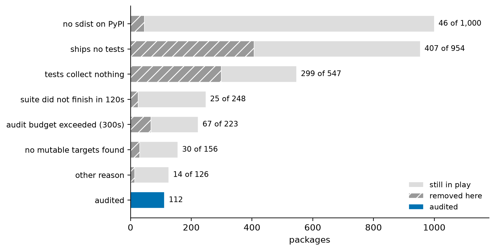
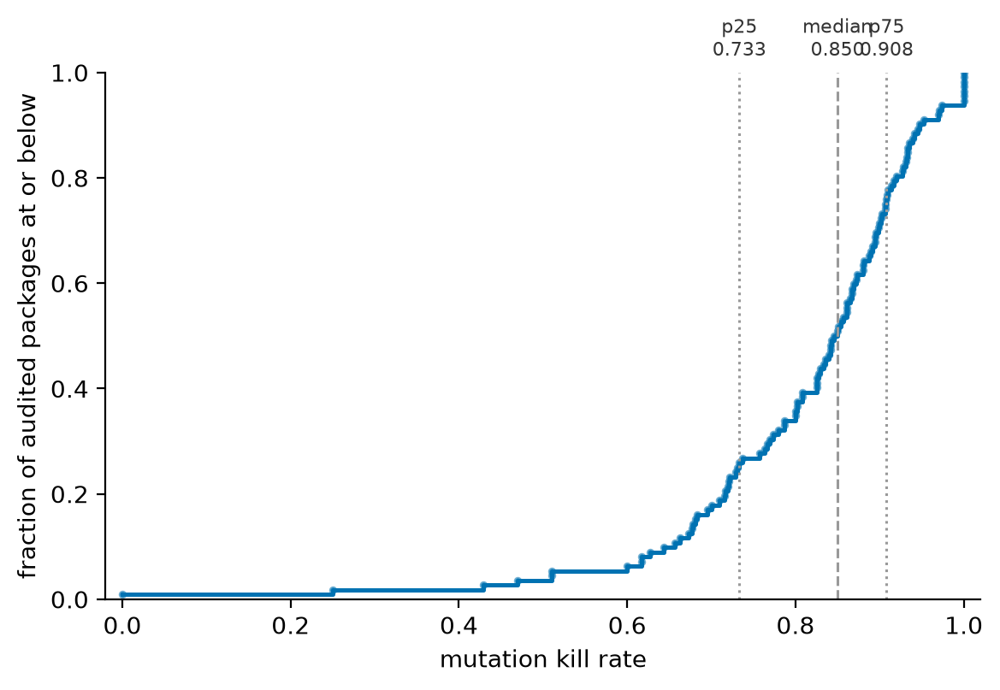
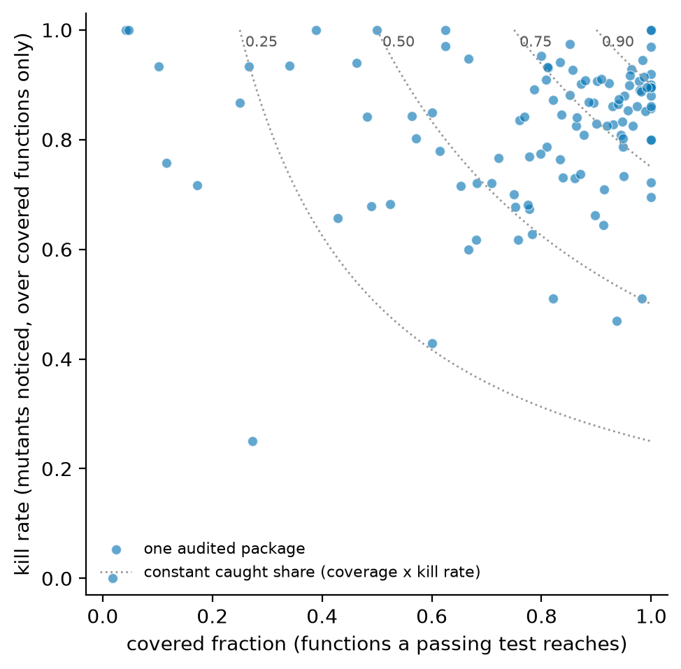
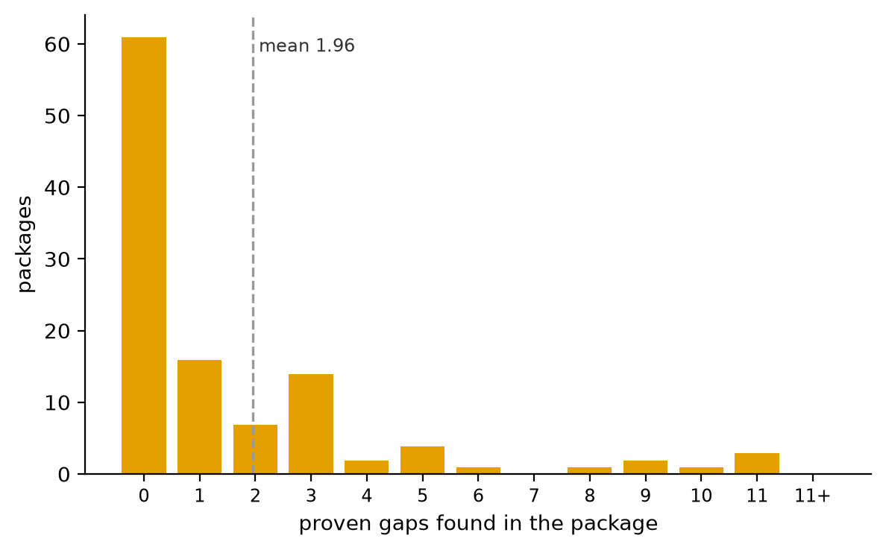

# Abstract

Mutation testing is a mature field with a practical problem: at corpus scale it is, in the
words of one observational study of large Java projects, *computationally intractable*.
Python work is correspondingly small — a recent fault-driven approach is evaluated on 13
applications, and the available tool comparisons run on two programs each.

We attempted to audit the **1,000 most-downloaded packages on PyPI** and report the funnel
rather than only the survivors. **407 ship no test directory. 299 ship tests that collect
nothing. 112 could be audited** — 11.2%, 95% CI [9.4%, 13.3%], or 20.5% [17.3%, 24.1%] of
the 547 that published an sdist containing tests. That funnel is the paper's first result:
the headline obstacle to large-scale mutation study of Python is not compute, it is that
most distributions do not ship a runnable suite.

Within the 112, median kill rate is 0.85 (IQR 0.73–0.91), but kill rate is measured over
covered functions only; the unconditional **caught share** — the fraction of a package's
functions both reached and checked — has a median of **0.71** (IQR 0.49–0.82), and
**45.5% [36.6%, 54.8%] carry at least one gap we can
prove** — a surviving mutant with a witness: an argument set on which the original and the
mutant are **both executed and return different values**. Mutants that survive without
such a witness are **refused with a reason** rather than reported, which is the design
decision the comparison below turns on. The witness is a machine check on every one of
the 219 gaps; one gap was additionally confirmed by hand, by installing the mutant and
running the package's whole suite (§4).

Against `cosmic-ray` on `xmltodict` 1.0.4, that discipline found a gap `cosmic-ray` cannot
express: `drop_return` on `_process_namespace`, a mutant under which **all 119 tests pass**.
`cosmic-ray` generated 11 mutants inside the same function and killed all eleven, and
across 413 mutants used 64 distinct operators **none of which removes or replaces a
`return`**.

# 1. Introduction

A test suite's coverage says which lines ran, not whether running them would have caught
anything. Mutation testing answers the second question and is expensive, so studies are
small or ecosystem-narrow.

**Related work.** A recent Python-specific fault-driven mutation approach is evaluated on
13 open-source applications, drawing its operators from a catalogue of bug and fix patterns
mined from over 1,000 projects [@pytation]. A comparison of five Python mutation tools —
MutPy, Mutmut, Mutatest, Poodle, Cosmic Ray — applies them to two programs. An
observational study of large Java projects relates mutation score to coverage and records
that scoring every file in a corpus is intractable [@mindthegap]. A GitHub mining study
finds mutation testing in practice diverging from the tools in the literature, with
adoption driven by industry.

**The denominator, and a claim this paper used to make about it.** An earlier draft said
that no study reports how many projects it could *not* audit, or why. That is false, and
it is the third absence-based claim in this author's related work to fail on a second
literature pass; the other two were a novelty claim about executing dependency updates to
detect behavioural breakage, and one about measuring in-domain against out-of-domain
language identification. Teralizer
[@teralizer] reports exactly such a funnel: of 632 RepoReapers projects **1.7% completed
its pipeline**, with the attrition attributed per stage, and its stage percentages are
given against both the full pool and the stage input — the two readings this paper also
reports. Build-attrition studies make the same move outside mutation testing, one
reporting 38% of snapshots buildable and another 62% of commits per project not
compilable.

The honest gap is narrower. Those funnels are Java, and they are reported in service of
another contribution — a generalisation pipeline, a build-reproducibility study — rather
than as the result. What this paper adds is the funnel **as the finding**, over a sample
drawn by PyPI download rank rather than by GitHub stars, with a Wilson interval at every
stage, and with the kill rates read back through it so the selection bias the funnel
creates is attached to the numbers it biases (§5). The number itself is the point: most
of the top 1,000 cannot be audited at all.

**Contributions.**

1. The **auditability funnel** over PyPI's top 1,000, with Wilson intervals at each stage
   and both unconditional and conditional readings (§3).
2. **Trivial Compiler Equivalence transferred to Python**, with the measurement the
   literature does not have: **0.062% equivalent and 5.38% duplicate over 43,557
   mutants** from 24 sources, against over 7% and over 21% for C — and both rates
   concentrated in a single operator each, 4.29% equivalent for `swallow_except` and
   23.6% duplicate for `negate_if`, with four of the twelve operators producing neither
   (§3.2).
3. **Proof-backed gap reporting** — a surviving mutant is a finding only with a witness,
   and refusals carry reasons (§2).
4. A comparison with `cosmic-ray` locating a gap outside its operator set, and the
   observation that operator-set differences, not suite quality, dominate disagreement
   between mutation tools (§4).
5. An explicit statement of the **selection bias** the funnel creates, and why the audited
   kill rates are an upper bound rather than an estimate (§5).

# 2. Method

Each package's sdist is built in its own virtual environment and its suite must pass on its
own before anything is mutated — a suite that fails unmutated cannot be used to judge a
mutant. Mutants are generated within the distribution's **declared package scope**, read
from `pyproject.toml`'s wheel configuration, so vendored third-party code inside a
distribution is not counted as the package's own: before this rule, one audit attributed
222 vendored functions to its host.

A surviving mutant becomes a reported gap only when the tool can produce a **witness** — an
argument set on which original and mutant return different values, both calls completing.
Everything else is a refusal with a reason: the mutant could not be reached, no argument
set could be constructed, the function needs an instance the tool cannot build, or the
difference appeared only where one version rejected a generated argument. The audit
publishes both counts, so a reader can see how much of a surviving-mutant total is a claim
and how much is an absence of evidence.

# 3. The funnel

| Stage | Excluded | Of all 1,000 | Of those reaching it |
|---|---:|---|---|
| no sdist on PyPI | 46 | 0.046 [0.035, 0.061] | 0.046 of 1,000 |
| **ships no tests** | **407** | **0.407 [0.377, 0.438]** | 0.427 of 954 |
| **tests collect nothing** | **299** | **0.299 [0.271, 0.328]** | 0.547 of 547 |
| suite did not finish in 120 s | 25 | 0.025 [0.017, 0.037] | 0.101 of 248 |
| memory cap exceeded (4,096 MB) | 4 | 0.004 [0.002, 0.010] | 0.018 of 223 |
| audit budget exceeded (300 s) | 60 | 0.060 [0.047, 0.076] | 0.274 of 219 |
| audit budget exceeded (longer) | 3 | 0.003 [0.001, 0.009] | 0.019 of 159 |
| no mutable targets | 30 | 0.030 [0.021, 0.043] | 0.192 of 156 |
| other | 14 | 0.014 [0.008, 0.023] | 0.111 of 126 |
| **audited** | **112** | **0.112 [0.094, 0.133]** | — |

The three budget rows were one row reading **67** in an earlier draft of this table.
`metrics.py` matched each exclusion reason by substring, and `memory budget exceeded:
4,718 MB over the 4,096 MB cap` contains the substring `budget exceeded`, so four
memory-cap exclusions and three from a longer budget were published as having exceeded a
300-second *time* budget. A funnel is a classification, and a stage that absorbs a
neighbouring criterion overstates itself by exactly as much as it understates the other.

Both readings are given because they are different claims. "11.2% of the top 1,000 are
auditable" is true; so is "20.5% [17.3%, 24.1%] of those shipping an sdist with tests are
auditable", and a paper that quotes one without the other is choosing a number.

Within the 112:

| | median | IQR | min | max |
|---|---:|---|---:|---:|
| kill rate (over covered functions) | 0.848 | 0.731–0.908 | 0.000 | 1.000 |
| covered fraction | 0.859 | 0.681–0.956 | 0.019 | 1.000 |
| **caught share** (their product) | **0.709** | 0.494–0.816 | 0.000 | 1.000 |
| mutants scored | 97 | 35–181 | 1 | 1,669 |
| proven gaps | 0 | 0–2.8 | 0 | 33 |

**Kill rate and covered fraction are not siblings and must not be read as a pair.** Only
functions a passing test reaches are mutated, so kill rate is measured over the covered
subset and is *conditional on* the covered fraction. The two share no denominator and
neither bounds the other. Two packages in this sample make the point concretely:
These medians are `statistics.median`. An earlier draft took them from a nearest-rank
quantile, which over an even sample returns the upper of the two middle values and gave
0.850 and 0.861 — the same quantity the README published as 0.848 and 0.859 from the same
112 rows. One repository reporting one median twice is a defect whichever value is right.
The quartiles are `statistics.quantiles`, so the whole row now comes from one definition.

`pyasn1-modules` and `jaraco-context` both score a **kill rate of 1.000** on covered
fractions of **0.042** and **0.048**, so a perfect mutation score is reported while 96%
of each package is never examined. Six packages cover under 20% of their functions, and
five of those have a caught share below 0.125.

The unconditional quantity is their product, the **caught share** — the fraction of a
package's functions that are both reached by a test and checked by one. Its median is
**0.709** against a median kill rate of 0.848, and its lower quartile is 0.494 against
0.731. Reporting kill rate alone overstates how much of a package is actually audited by
roughly fourteen points at the median and twenty-four at the lower quartile. Figure 3
plots the two axes with iso-contours of their product, which is the only comparison
between them that is defined.

**45.5% [36.6%, 54.8%] of audited packages carry at least one proven gap.** The median
package has none, so the distribution is the finding: proven gaps are concentrated, as the
mutants-scored range (1 to 1,669) suggests they would be.

## 3.1 Figures



**Figure 1.** From PyPI's 1,000 most-downloaded packages to the 112 that could be audited,
one row per filter, each giving what the filter removed over what reached it.



**Figure 2.** Empirical distribution of kill rate over the 112 audited packages, with
quartiles marked. An ECDF rather than a histogram: the bin width of a histogram would be a
free parameter doing argumentative work at the left tail, where the interesting packages
are.



**Figure 3.** Covered fraction against kill rate with dotted iso-contours of their
product. Distance from the origin, not distance from a diagonal, is the thing to read: the
axes are not comparable to each other because kill rate is conditional on coverage.



**Figure 4.** Proven gaps per audited package, counts of 11 and above collected in the last
bar. The median package has none and the maximum is 33, so the mean of 1.96 describes no
package in the sample.

## 3.2 How many of these mutants are the same program?

A kill rate is a rate over a mutant set, so the set has to be free of mutants that cannot
be killed and of mutants counted twice. Papadakis et al. [@tce2015] settle both with the
compiler rather than with analysis: compile every mutant, and if one compiles to the
original's binary it is **equivalent**; if two compile to each other's they are
**duplicates**. On large C programs they discard over 7% as equivalent and over 21% as
duplicates, and report a detection rate against hand-analysed ground truth of about 30%
for C against about 54% for Java — a gap they attribute to mutation characteristics being
language-dependent.

Python is not in that series, and the reason usually given — CPython has no optimising
compiler, so nothing collapses two programs into one form — is a hypothesis.
`src/suite_auditor/tce.py` compiles each mutant and canonicalises the result: the
instruction stream with every operand resolved to the value it names, plus the function's
name, its docstring and its exception table, with filenames, line numbers and position
tables dropped. Not `co_code`: CPython folds `60 * 60` to `3600` and then leaves the
unused `60` in `co_consts`, so the folded mutant and the literal original have identical
instructions over different tables and different operands, and comparing bytes calls them
different — which is the textbook equivalent mutant, missed.

Over **43,557 mutants** from this tool's twelve operators across 24 sources: five
repositories and **nineteen third-party packages installed from PyPI**.

| | C [@tce2015] | **Python (this work)** |
|---|---:|---:|
| equivalent | > 7% | **27 of 43,557 — 0.062%** |
| duplicate | > 21% | **2,344 of 43,557 — 5.38%** |

Both are smaller than C — the equivalent share by a factor of about a hundred, the
duplicate share by about four — and neither is zero. The first run of this measurement covered only the five repositories and reported
**0 of 2,467 equivalent**, which is what a rate of 0.062% predicts for a sample that size
(1.5 expected) and is not evidence that this author's code differs. The nineteen
third-party packages are in the corpus because five repositories by one author are not a
sample of Python, and adding them is what turned a zero into a number.

**Neither rate is a property of Python. Both are properties of one operator each.**

| operator | mutants | equivalent | duplicate |
|---|---:|---:|---:|
| `swallow_except` | 606 | **26 — 4.29%** | 33 — 5.4% |
| `negate_if` | 9,062 | 0 | **2,137 — 23.6%** |
| `const` | 5,133 | 1 — 0.02% | 44 — 0.9% |
| `slice_upper` | 554 | 0 | 33 — 6.0% |
| `compare` | 7,102 | 0 | 70 — 1.0% |
| the other seven | 21,100 | **0** | 27 — 0.1% |

`swallow_except` replaces an `except` body with `pass`. Applied to a handler whose body
is `return None` it writes a program CPython compiles identically, because falling off
the end of a function returns `None`. The instance in `packaging` is the whole mechanism:

```python
try:
    return __import__("_manylinux")
except ImportError:
    return None  # mutated to: pass
```

26 of the 27 equivalent mutants are that shape. The twenty-seventh is `const` in `twine`:
`hashlib.blake2b(digest_size=256 // 8)` mutated to `257 // 8`, and CPython folds both to
`32` before emitting a constant. All of them are unkillable by construction — no test can
distinguish them — so every one was a guaranteed survivor depressing the kill rate of
whatever function it was in.

`negate_if` wraps an `if` test in `not`. From `if not items:` it writes
`if not not items:`, which compiles to exactly what `drop_not` writes from the same line,
`if items:`; from `if x is None:` it writes `if not x is None:`, which is `compare`'s
`if x is not None:`. Nearly a quarter of that operator's mutants are a program the set
already contains.

**What this changes, and what it does not.** The tool now filters before scoring and
publishes the counts in its JSON output, so a reader can see which set a rate was taken
over. The 112 published audits were run before the filter existed, and re-running a
thousand-package census is not affordable, so the effect on §3's medians is given as a
bound rather than a correction. A duplicate is killed exactly when its twin is, so
removing $d$ of $N$ mutants of which $k$ were killed takes $K/N$ to $(K-k)/(N-d)$: at
$d/N = 0.0538$ and a median kill rate of 0.848, the filtered median lies in
**[0.839, 0.896]**, the endpoints being all duplicates killed and none killed. Equivalent
mutants move it the other way and unambiguously: every one is a survivor, so removing
0.062% of mutants that were all counted as unkilled raises the rate very slightly. The
interval is narrow enough that no claim in §3 turns on it, which is why it is published
as an interval rather than used to restate the medians.

# 4. Comparison with `cosmic-ray`

Same machine, same virtualenv, `xmltodict` 1.0.4 (19 functions, 119 tests):

| | `cosmic-ray` 8.4.1 | this tool |
|---|---:|---:|
| mutants generated | 413 | 89 |
| killed | 345 | 81 (91.0%) |
| survivors | 68 (16.5%) | 8 |
| …proven to behave differently | — | **1** |
| …refused, with a reason | — | 7 |
| wall clock | 351 s | 28 s |

**The rates are not comparable, and the reason is the finding.** `cosmic-ray`'s 68
survivors sit at 33 source positions, and 22 of them are one family at **two** positions —
every binary substitution of a single `*`. A survival rate over a mutant set built that way
measures the operator set as much as the suite.

The single proven gap is `drop_return` on `_process_namespace`: `return name` replaced by
`return None` in its non-string guard, witness `_process_namespace(1, None, ':')` → `1` vs
`None`, 6 of 64 argument sets disagreeing. **Verified by hand: with that mutant in place,
all 119 tests pass.** `cosmic-ray` generated 11 mutants inside that same function and
killed all eleven, and across 413 mutants used 64 distinct operators, **not one of which
removes or replaces a `return`**. The defect is outside its operator set on this target.

Stated as narrowly as it deserves: `cosmic-ray`'s 68 survivors were not individually
examined, so some are very likely real gaps this tool never generated — the reverse case. A
fair recall comparison needs a shared operator set, which neither tool offers.

# 5. Threats to validity

**Selection bias, and its direction.** The 112 are the packages that ship a suite, whose
suite passes alone, and that fit a 300-second budget. Every one of those filters plausibly
correlates with test quality, so the audited sample is biased **towards better-tested
packages** and the kill rates are an **upper bound** on the population, not an estimate of
it. The excluded packages have no kill rate by construction, so there is nothing to
adjust with — but the 63 budget-exceeded and 25 did-not-finish packages are recoverable at
greater compute, and §5.1 recovers a sample of them rather than asserting what they would
have scored.

**A kill rate depends on the operator set** (§4), so the median 0.848 is this tool's
operator set on these packages and is not comparable to a figure from another tool.

**The published rates were measured before the TCE filter.** §3.2 bounds the effect at
[0.839, 0.896] around a median of 0.848 and does not resolve it. A census run after the
filter would resolve it, and has not been run.

**Proven gaps are a lower bound.** The tool refuses what it cannot witness, so the 45.5%
counts only provable gaps; the true share of packages with a real gap is higher by an
unknown amount. This is the intended direction of error.

**One interpreter, one platform, one time budget.** The 300-second budget excluded 60
packages, and the budget rows together 63 — the largest single recoverable exclusion, and
the subject of §5.1.

## 5.1 Re-measuring the budget exclusions

The claim that a time budget is "the largest recoverable exclusion" was worth testing
rather than stating, so 12 of the 63 budget-exceeded packages were re-audited at a
1,800-second budget, the same code otherwise. `scripts/target_census.py --only` takes the
names, filtered against the external top-downloads list so that re-measuring a subset
cannot become hand-picking one.

**7 of the 12 completed.** The five that did not split three ways, which is itself the
point: one exceeded even 1,800 s, two exceeded the 4,096 MB memory cap, and two failed to
install inside the install timeout. A single "budget exceeded" label covers four
different things.

| | median | range |
|---|---:|---|
| kill rate, the 7 recovered | **0.848** | 0.669–0.909 |
| kill rate, the 112 published | **0.848** | 0.000–1.000 |
| covered fraction, the 7 recovered | 0.839 | 0.805–0.975 |
| covered fraction, the 112 published | 0.859 | 0.019–1.000 |

**The recovered packages score like the included ones.** Median kill rate 0.848 against
the published 0.848; 6 of the 7 carry at least one proven gap, 21 in total, against 51 of
112. The budget exclusion is therefore a limit on the census's *coverage* and not visibly
a bias in its rate — which is the opposite of what the selection-bias paragraph above
would predict, and is reported because it was measured rather than assumed.

**The budget is partly a property of the machine, not of the project.** Four of the seven
finished in 171, 185, 194 and 203 seconds, and a fifth in 302 — inside, or within 1%, of
the 300-second budget that had excluded them. The same audits, the same code, a less
loaded machine. A wall-clock budget is not a stable exclusion criterion, so the 60-package
row of the funnel is not a reproducible fact about those 60 packages. A budget in work
done — mutants planned, or test-runs executed — would be; this one is not, and that is a
limitation of the census rather than of the tool.

# 6. Reproducibility

`docs/census-rows.json.gz` (156 KB) holds one row per package with every aggregate the
summary reads and no mutated source. `python scripts/census_summary.py --census
docs/census-rows.json.gz` reproduces the committed summary, which a test checks, so every
figure here rebuilds from the repository without the 19 MB raw census.

# References

- [@pytation] *PyTation: fault-driven mutation for Python.* arXiv:2601.19088.
- [@mindthegap] *Mind the Gap: The Difference Between Coverage and Mutation Score Can Guide Testing Efforts.* arXiv:2309.02395.
- *Static and Dynamic Comparison of Mutation Testing Tools for Python.* SBQS.
- *cosmic-ray* — mutation testing for Python. <https://github.com/sixty-north/cosmic-ray>
- [@tce2015] Papadakis, M., Jia, Y., Harman, M. and Le Traon, Y. *Trivial Compiler
  Equivalence: A Large Scale Empirical Study of a Simple, Fast and Effective Equivalent
  Mutant Detection Technique.* ICSE 2015, pp. 936–946. Over 7% of mutants discarded as
  equivalent and over 21% as duplicates on large C programs; detection against
  hand-analysed ground truth about 30% for C and about 54% for Java.
  <https://doi.org/10.1109/ICSE.2015.103>
- [@teralizer] Glock, Bauer & Pinzger. *Teralizer: Semantics-Based Test Generalization
  from Conventional Unit Tests to Property-Based Tests.* arXiv:2512.14475, December 2025.
  Cited for its eligibility funnel; quoted from the abstract, which states the 632
  projects and the 1.7% completion rate.

> **Citation status.** The references were located by literature search and quoted from
> search summaries, not read in full. The one claim flagged here for a confirmatory pass
> — that no comparable study reports its excluded denominator — was given that pass and
> **did not survive it**: Teralizer [@teralizer] reports a per-stage funnel over 632
> projects against both denominators, and §1 now cites it and states a narrower gap. That
> makes three absence-based claims across these papers that a second search overturned
> and none that it confirmed, which is a fact about the method rather than about any one
> claim: an absence found by literature search is not a result here, and the remaining
> references still need reading in full before submission.
